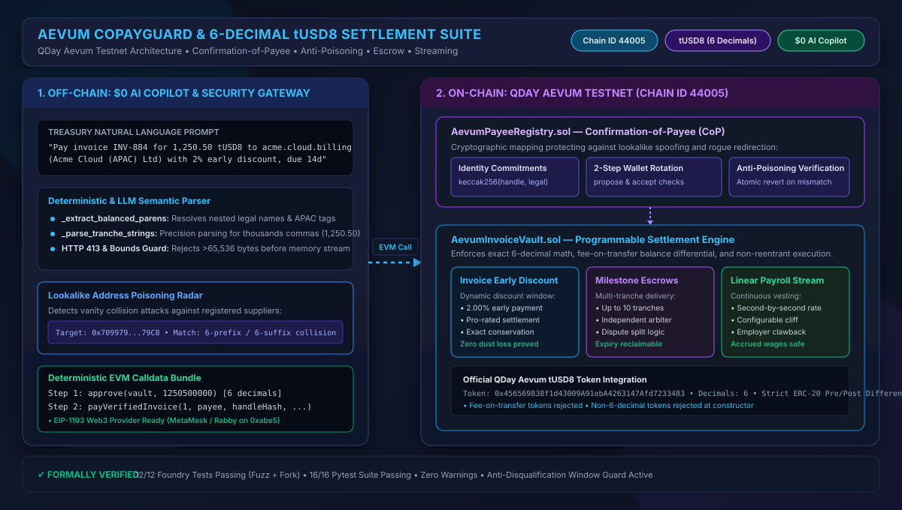
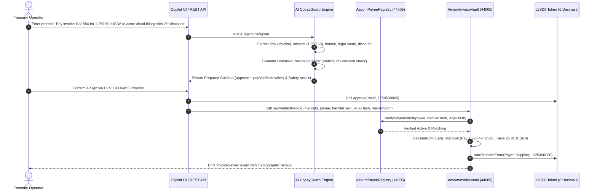

# Aevum CopayGuard & 6-Decimal tUSD8 Settlement Suite

[](https://explorer-test.qday.info)
[-indigo.svg)](https://rpc-test.qday.info)
[](https://explorer-test.qday.info/token/0x456569838f1d43009A91ebA4263147Afd7233483)
[](LICENSE)
[]()
[]()
[]()
[](https://khanhtnq.github.io/aevum-copayguard-protocol/)

> **The Enterprise-Grade Stablecoin Settlement Engine on QDay Aevum.**  
> Unifying on-chain **Confirmation-of-Payee (CoP)** anti-address-poisoning identity verification, atomic 6-decimal `tUSD8` invoice early-discount settlement, milestone-gated escrows, continuous linear payroll streaming, and a **$0 local AI Copilot & Poisoning Radar** running against QDay Aevum Testnet (Chain ID `44005`).
>
> **Live Walkthrough & Telemetry:** [https://khanhtnq.github.io/aevum-copayguard-protocol/](https://khanhtnq.github.io/aevum-copayguard-protocol/) | **Direct 1080p MP4:** [demo_1080p.mp4](https://khanhtnq.github.io/aevum-copayguard-protocol/demo_1080p.mp4)

---

## 1. Problem: Why Enterprise Stablecoin Payments Fail Today

Global enterprise treasuries moving billions in stablecoins face three acute operational and security bottlenecks:

1. **Address Poisoning & Vanity Lookalike Attacks**: Malicious actors generate vanity addresses mirroring the first 4–6 and last 4–6 characters of legitimate suppliers, spamming 0-value transfers into enterprise treasury history. Unwary accounting staff copy-pasting from block explorers accidentally route treasury funds directly to attackers.
2. **Lack of Confirmation-of-Payee (CoP)**: While TradFi banking (SEPA CoP, UK Confirmation of Payee, FedNow) mandates real-time account name and legal entity verification before wire execution, Web3 transactions blindly settle to raw hex addresses with zero verification of supplier handle or corporate identity.
3. **Inflexible Settlement Primitives & Token Quirks**: B2B agreements require early-payment discount incentives (e.g. *2/10 net 30*), multi-tranche milestone escrows with independent arbiter dispute resolution, and continuous second-by-second linear payroll streaming. Furthermore, naively assuming 18-decimal ERC-20 math leads to catastrophic precision errors on 6-decimal native stablecoins like `tUSD8`.

---

## 2. Solution: The Aevum CopayGuard Architecture

Aevum CopayGuard delivers a unified dual-layer payment architecture designed specifically for the high-throughput, low-latency QDay Aevum Network:

- **On-Chain Settlement Protocol (`src/`)**:
  - `AevumPayeeRegistry.sol`: On-chain Confirmation-of-Payee registry storing cryptographic hashes of supplier handles, legal entity names, and IPFS metadata, backed by a strict two-step owner-controlled wallet rotation mechanism.
  - `AevumInvoiceVault.sol`: High-performance programmable settlement engine enforcing exact 6-decimal `tUSD8` token conservation, fee-on-transfer rejection, non-reentrant state transitions, dynamic early-payment discounts, 10-tranche milestone escrows, and linear second-by-second vesting streams.
- **Off-Chain AI Copilot & Poisoning Radar (`aevum_copilot/`)**:
  - `$0` Local AI Parsing Engine: Supports local Ollama (`qwen2.5:7b-instruct` / `deepseek-r1`) with an instant deterministic grammar-based fallback parser.
  - Lookalike Address Poisoning Radar: Analyzes candidate addresses against trusted supplier registries, detecting prefix/suffix character collision attacks with visual warning banners.
  - Interactive Web Dashboard & REST API: Live RPC telemetry, account balance queries, one-click calldata compilation, and direct browser wallet switching (MetaMask / Rabby).

---

## 3. System Architecture & Settlement Workflow





---

## 4. Smart Contract Specifications

### 4.1 AevumPayeeRegistry (`src/AevumPayeeRegistry.sol`)
Stores and verifies on-chain business identities:
- `registerPayee(bytes32 handleHash, bytes32 legalNameHash, bytes32 metadataHash)`: Registers the caller as the verified owner of a supplier profile.
- `proposeWalletRotation(bytes32 handleHash, address newWallet)` & `acceptWalletRotation(bytes32 handleHash)`: Two-step secure wallet transfer preventing key compromise or accidental takeover.
- `verifyPayeeMatch(address payee, bytes32 handleHash, bytes32 legalNameHash)`: Reverts with custom errors if the wallet address is inactive, unregistered, or mismatches the cryptographic legal name commitment.

### 4.2 AevumInvoiceVault (`src/AevumInvoiceVault.sol`)
Enforces mathematical conservation and handles all financial primitives:
- **Strict 6-Decimal Verification**: Inspects `IERC20Metadata.decimals() == 6` in the constructor. Rejects any token standard mismatch.
- **Exact Transfer Accounting**: Protects against fee-on-transfer, deflationary, or rebasing tokens by checking pre/post balance differentials.
- **Confirmation-of-Payee Invoicing**:
  - `createInvoice(...)`: Issuer creates an invoice with principal, early-discount basis points (up to 50.00%), discount deadline, and final maturity.
  - `payVerifiedInvoice(...)`: Payer settles atomically. If paid before `discountDeadline`, the vault applies the discount and refunds or reduces the required `tUSD8` pull.
- **Milestone Escrows**:
  - `createMilestoneEscrow(...)`: Locks up to 10 sequential tranches.
  - `releaseMilestoneTranche(...)`: Payer or arbiter releases specific tranches upon milestone verification.
  - `resolveDispute(...)`: Designated arbiter splits contested escrow balances with zero dust loss.
  - `reclaimExpiredEscrow(...)`: Allows payer refund if milestones are abandoned past expiration.
- **Continuous Payroll Streaming**:
  - `createPayrollStream(...)`: Deposits funds for second-by-second linear vesting.
  - `claimStreamPayroll(...)`: Recipient claims vested `tUSD8` at any second after cliff expiration.
  - `cancelPayrollStream(...)`: Employer halts stream, instantly paying accrued wages to recipient and returning unvested capital to employer.

---

## 5. QDay Aevum Testnet Deployment Information

All protocol contracts interface with official QDay Aevum Testnet infrastructure:

| Parameter | Value |
|:---|:---|
| **Network Name** | QDay Aevum Testnet |
| **Chain ID** | `44005` (`0xabe5`) |
| **Public RPC URL** | `https://rpc-test.qday.info` |
| **Block Explorer** | `https://explorer-test.qday.info` |
| **Native Gas Token** | `tQDAY` (18 decimals) |
| **tUSD8 Stablecoin** | `0x456569838f1d43009A91ebA4263147Afd7233483` (6 decimals) |
| **tUSD8 Faucet** | `0x4551B2a3dE4F43e6613E23edf798Ab4FB0211564` |
| **tQDAY Faucet** | `0x33d19Bde2e1798c13808f17BfBa1780b28e4bACC` |

---

## 6. Installation & Verification Guide

### 6.1 Prerequisites
- [Foundry](https://getfoundry.sh/) (`forge`, `cast`)
- Python 3.11+
- [Ollama](https://ollama.com/) *(optional, for local LLM inference)*

### 6.2 Smart Contract Compilation & Test Suite
```bash
# Build contracts with zero compiler warnings
forge build --deny-warnings

# Run comprehensive unit, fuzz, and live fork test suites
forge test -vv
```

The test suite validates:
1. `testFuzz_EarlyDiscountSettlementConservation`: Fuzz tests early discount splits across varying amounts and basis points.
2. `testFuzz_PayrollStreamExactConservation`: Mathematical invariant proving linear vesting claims plus refunds equal exact deposit.
3. `test_AddressPoisoningAndWalletRotationMismatchBlocked`: Reverts payment when candidate address does not match registered payee hash.
4. `test_FeeOnTransferTokenRejected`: Prevents vault exploitation via token transfer balance discrepancies.
5. `test_ReentrancyAttackBlockedOnStreamClaim`: Proves CEI pattern and reentrancy guard prevent reentrant draining.
6. `test_LiveAevumFork_EndToEndInvoiceEscrowAndPayrollFlow`: Executes a live state fork against `https://rpc-test.qday.info` verifying real `0x456569838f1d43009A91ebA4263147Afd7233483` token mechanics.

### 6.3 Python Copilot & Web Server Setup
```bash
# Install package and dependencies
pip install -e .

# Run Python regression and ABI parity tests
python -m pytest tests_py -v

# Run Ruff linter
python -m ruff check aevum_copilot tests_py scripts
```

### 6.4 Launch Interactive Dashboard & REST API
```bash
# Launch server locally
aevum-copilot serve --host 127.0.0.1 --port 8088
```
Open [http://127.0.0.1:8088](http://127.0.0.1:8088) in your browser:
- Query real-time block numbers and `tUSD8` balances directly from QDay Aevum Testnet RPC.
- Select preset enterprise invoices, milestone escrows, and payroll streams.
- Trigger synthetic lookalike poisoning attacks to witness real-time blocking and security verdicts.
- Connect MetaMask or Rabby to switch automatically to QDay Aevum Testnet (`0xabe5`).

---

## 7. Docker Deployment

A production-ready minimal Docker container is included:

```bash
# Build Docker image
docker build -t aevum-copilot:latest .

# Run container exposing port 8088
docker run -d --name aevum-copilot -p 8088:8088 aevum-copilot:latest

# Check health endpoint
curl http://127.0.0.1:8088/api/health
```

---

## 8. REST API Reference & Examples

The `aevum-copilot` server exposes a hardened JSON REST API (strict `65,536`-byte payload cap, UTF-8 & JSON schema validation):

| Method & Endpoint | Description |
|:---|:---|
| `GET /api/health` | Service status, QDay Aevum network constants, and trusted payee directory |
| `GET /api/network` | Live QDay Aevum Testnet RPC snapshot (`eth_chainId`, `eth_blockNumber`, `tUSD8` metadata) |
| `GET /api/account?address=0x...` | Live `tQDAY` native gas balance and `tUSD8` 6-decimal balance for any EVM address |
| `POST /api/guard` | Runs Lookalike Address Poisoning Radar & Confirmation-of-Payee hash verification |
| `POST /api/copilot/plan` | Parses natural-language payment intent into verified ABI calldata + safety verdict |

```bash
# 1. Query live QDay Aevum Testnet snapshot
curl -s http://127.0.0.1:8088/api/network

# 2. Screen a candidate payee address for lookalike poisoning
curl -s -X POST http://127.0.0.1:8088/api/guard \
  -H "Content-Type: application/json" \
  -d '{"wallet":"0x7099790000000000000000000000000000dc79c8","handle":"acme.cloud.billing","legal_name":"Acme Cloud Infrastructure Ltd"}'

# 3. Compile verified invoice calldata from natural language
curl -s -X POST http://127.0.0.1:8088/api/copilot/plan \
  -H "Content-Type: application/json" \
  -d '{"instruction":"Pay invoice INV-884 for 1250.50 tUSD8 to acme.cloud.billing with 2% early discount"}'
```

---

## 9. Known Constraints & Future Roadmap

### Known Constraints
- **6-Decimal Token Invariant**: `AevumInvoiceVault` enforces `IERC20Metadata.decimals() == 6` at deployment and rejects 18-decimal or fee-on-transfer tokens by design to eliminate `1e12` scaling errors.
- **Bounded Escrow Tranches & Discounts**: Milestone escrows support up to `10` sequential tranches per agreement, and early-payment discounts are capped at `5000` bps (`50.00%`) to prevent misconfigured principal drains.
- **Testnet Faucet Gate**: Live contract broadcasts via `script/DeployAndProveAevum.s.sol` require `tQDAY` gas claimed from `https://faucet.qday.info/en` (Turnstile-gated). When `AEVUM_DEPLOYER_PRIVATE_KEY` is unset, `test/AevumLiveFork.t.sol` validates full end-to-end execution against a live fork of `https://rpc-test.qday.info`.

### Future Roadmap
1. **QDay Mainnet & Post-Quantum Readiness**: Deploy verified `AevumPayeeRegistry` and `AevumInvoiceVault` instances on QDay Mainnet with deterministic CREATE2 addresses.
2. **ERC-8004 & Agentic Session Keys**: Integrate scoped session keys and per-epoch `tUSD8` spend caps for autonomous AI treasury agents.
3. **Multi-Sig & Cross-Chain CoP Federation**: Add Gnosis Safe / multi-sig approval hooks for payee wallet rotations and shared enterprise Confirmation-of-Payee registries.

---

## 10. License

This repository is licensed under the [MIT License](LICENSE).
